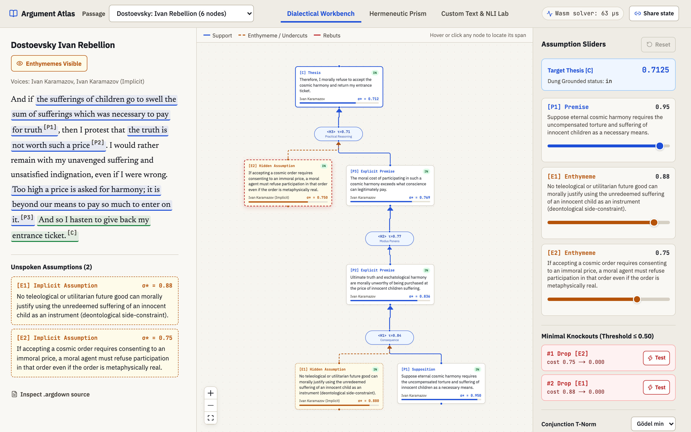
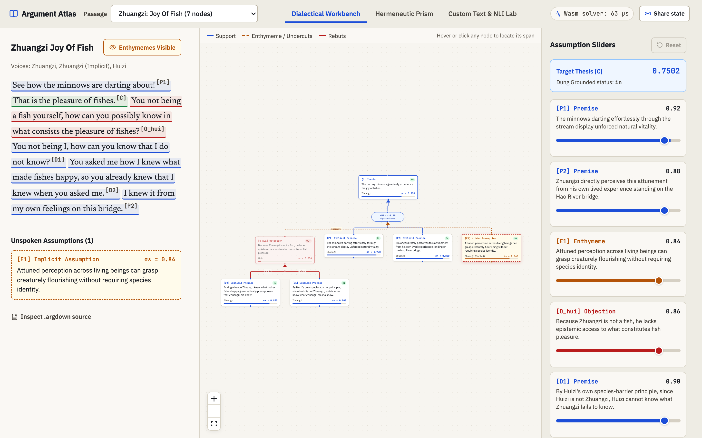
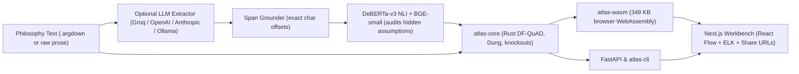

# Philosophy Argument Atlas (Dialectica Engine)

[](https://github.com/Bunlong-Prak/Philosophical-argument-atlas/actions/workflows/ci.yml)
[](crates/atlas-core/Cargo.toml)
[](crates/atlas-wasm/Cargo.toml)
[](backend/pyproject.toml)
[](LICENSE)

Argument Atlas turns dense philosophical passages into formal argument hypergraphs, audits unspoken assumptions with local Natural Language Inference (NLI), and solves which claims survive attack in about 50 microseconds. The Rust solver (`atlas-core`) compiles straight to WebAssembly (`atlas-wasm`), so you can drag credence sliders, knock out hidden premises, and share exact counterfactual URLs in your browser with zero backend required.

Want the short visual tour first? Read [the ADHD-friendly guide](docs/GUIDE.md).



## See it work in 30 seconds

Take Fyodor Dostoevsky's *The Brothers Karamazov* (Book V, Ch. 4, Constance Garnett 1912 translation), stored in [03_dostoevsky_ivan_rebellion.argdown](datasets/phil-args/03_dostoevsky_ivan_rebellion.argdown):

> "Too high a price is asked for harmony; it is beyond our means to pay so much to enter on it. And so I hasten to give back my entrance ticket."

Ivan Karamazov's explicit sentences need two unspoken bridge assumptions (*enthymemes*) to reach his refusal:
- `[E1]` No future good justifies using an innocent child's uncompensated suffering as an instrument (credence `0.88`).
- `[E2]` If accepting cosmic harmony requires consenting to an immoral price, a moral agent must refuse participation (credence `0.75`).

Run the Rust CLI on that passage:

```bash
cargo run --release -p atlas-cli -- inspect datasets/phil-args/03_dostoevsky_ivan_rebellion.argdown --strict-spans
```

In `44` microseconds, `atlas-cli` checks every quote character-for-character against the source text, computes gradual `DF-QuAD` belief scores (`C = 0.7125`), compiles discrete Dung extensions (`Grounded`, `Preferred`, `Stable`), and ranks the weakest assumptions whose rejection collapses Ivan's thesis (`C -> 0.0000`):

```text
 #1  Remove ["E2"] | epistemic_cost=0.75 | [C]: 0.7125 -> 0.0000 (drop=0.7125)
 #2  Remove ["E1"] | epistemic_cost=0.88 | [C]: 0.7125 -> 0.0000 (drop=0.7125)
```

## Measured benchmark results (`PhilArgs-12`)

Reproduce every number below on your own machine with `make benchmark` ([eval_full_benchmark.py](backend/scripts/eval_full_benchmark.py)):

| Experiment | Metric | Observed result | Why it matters |
| :--- | :--- | :--- | :--- |
| **Hypergraph vs. flat-graph ablation** | False thesis survivals on #1 premise knockout | **`9 / 9` (`100.0%`)** flat-graph failures vs. **`0 / 9`** in `atlas-core` | Standard node-to-node graphs leave defeated theses above `0.86` because linked premises leak support independently; conjunctive hyperedges collapse to `0.0000`. |
| **Symbolic solver speed** | Median native CLI / browser Wasm latency | **`44 us`** CLI (`36` to `105 us`) / **`~63 us`** Wasm | Fast enough to recompute continuous `DF-QuAD`, discrete Dung extensions, and hitting-set knockouts at 60fps while dragging sliders. |
| **Enthymeme anti-cheating audit** | `DeBERTa-v3` + `BGE-small` Top-1 accuracy | **`5 / 5` (`100.0%`)** across 20 candidates | Ranks real philosophical bridge premises #1 ahead of circular conclusion paraphrases and lazy `"If P, then C"` tautologies. |
| **Hermeneutic Prism alignment** | Explicit F1 vs. Enthymeme F1 (`tau = 0.72`) | **`0.917`** Explicit F1 vs. **`0.578`** Enthymeme F1 | Across 6 rival philosophical lenses, competing readings agree on text-grounded quotes while splitting on unspoken background commitments. |


## The `PhilArgs-12` multi-tradition corpus

Every file in [datasets/phil-args](datasets/phil-args) uses public-domain translations and passes `--strict-spans` character-offset verification (`0` quote drift allowed). Paired rival interpretations live in [datasets/hermeneutic-lenses](datasets/hermeneutic-lenses).

| # | Passage | Tradition & work | Dialectical structure tested | Baseline thesis |
| :--- | :--- | :--- | :--- | :--- |
| `01` | [Descartes: Cogito](datasets/phil-args/01_descartes_cogito.argdown) | Early Modern Rationalism (*Discourse* IV) | Conjunctive hyperedge + Lichtenberg undercutter lens | `0.7410` (`in`) |
| `02` | [Hume: Problem of Induction](datasets/phil-args/02_hume_problem_of_induction.argdown) | Scottish Empiricism (*Enquiry* IV) | Forked fork elimination (demonstrative vs. probable circularity) | `0.8190` (`in`) |
| `03` | [Dostoevsky: Ivan's Rebellion](datasets/phil-args/03_dostoevsky_ivan_rebellion.argdown) | Existential Ethics (*Brothers Karamazov* V.4) | 3-hop deontological chain + Theodicy rival lens | `0.7125` (`in`) |
| `04` | [Plato: Euthyphro Dilemma](datasets/phil-args/04_plato_euthyphro_dilemma.argdown) | Classical Greek (*Euthyphro*) | Socratic Pollock undercutter (`_>`) + direct rebuttal (`->`) | `0.0000` (`out`) |
| `05` | [Kant: Third Antinomy](datasets/phil-args/05_kant_third_antinomy.argdown) | Transcendental Idealism (*Critique of Pure Reason*) | Symmetric mutual rebuttal cycle (`Thesis <-> Antithesis` tie) | `0.4000` (`undecided`) |
| `06` | [Mill: Infallibility Argument](datasets/phil-args/06_mill_on_liberty_infallibility.argdown) | Classical Liberalism (*On Liberty* Ch. II) | Counterfactual censorship supposition defeated by fallibilism | `0.9120` (`in`) |
| `07` | [Anselm vs. Gaunilo](datasets/phil-args/07_anselm_ontological_argument.argdown) | Medieval Scholasticism (*Proslogion* II & *Lost Island*) | Two-step *reductio* undercut by Gaunilo's parody objection | `0.2133` (`out`) |
| `08` | [Spinoza: Substance Monism](datasets/phil-args/08_spinoza_substance_monism.argdown) | Geometric Rationalism (*Ethics* Part I, Prop. 14) | *More geometrico* multi-axiom synthesis | `0.7752` (`in`) |
| `09` | [Pascal: The Wager](datasets/phil-args/09_pascal_wager.argdown) | Decision Theory (*Pensees* §233) | Infinite expected utility + Diderot's Many-Gods rival lens | `0.6840` (`in`) |
| `10` | [Aristotle: Function (*Ergon*)](datasets/phil-args/10_aristotle_function_ergon.argdown) | Virtue Ethics (*Nicomachean Ethics* I.7) | Exclusionary division of nutritive, sensitive, and rational life | `0.7752` (`in`) |
| `11` | [Epicurus via Hume: Problem of Evil](datasets/phil-args/11_epicurus_hume_problem_of_evil.argdown) | Philosophy of Religion (*Dialogues* Part X) | Joint trilemma + Free-Will Defense rival lens | `0.7900` (`in`) |
| `12` | [Zhuangzi: Joy of Fish](datasets/phil-args/12_zhuangzi_joy_of_fish.argdown) | Classical Daoism (*Zhuangzi* Ch. 17, Qiushui) | Undercutter defeated by `tu quoque` & situated-knowing reinstatement | `0.7502` (`in`) |



## How the pieces fit



Standard argument mapping tools draw plain node-to-node arrows and stop there. That fails on real philosophical texts in three ways:

1. **Linked premises (`SupportHyperedge`).** In Descartes' *Cogito*, `"I think"` (`P1`) only reaches `"I exist"` (`C`) when paired with `"Whatever thinks must exist"` (`E1`). Modeling them as one conjunctive hyperedge `[P1] & [E1] +> [C]` guarantees that knocking out `E1` collapses the inference even when `P1` stays at `1.0`.
2. **Attacking a claim vs. attacking an inference (`UndercuttingAttack`).** Following John Pollock (1987), a rebuttal (`->`) denies a proposition directly, while an undercutter (`_>`) severs a support hyperedge without claiming its conclusion is false. In [12_zhuangzi_joy_of_fish.argdown](datasets/phil-args/12_zhuangzi_joy_of_fish.argdown), Huizi undercuts Zhuangzi's inference (`O_hui _> <H1>`), and Zhuangzi reinstates `<H1>` by defeating `O_hui` on its own bridge rules.
3. **NLI anti-cheating filters (`AbductiveNLIScorer`).** Language models asked for missing premises often emit `"If P, then C"` tautologies or restate `C` in new words. Our local `DeBERTa-v3` and `bge-small` scorer measures genuine entailment gain (`delta_nli`) while penalizing circular paraphrases and trivial conditionals.

## Quick start

### Option A: Zero-backend browser mode (Node.js `18+` only)

Because `web/public/` ships the compiled `349 KB` Rust WebAssembly solver (`atlas_wasm.wasm`) and pre-computed `PhilArgs-12` + `BGE-small` corpus bundle (`corpus-bundle.json`), you can run the interactive Workbench, Hermeneutic Prism, `.argdown` parser, and shareable URLs without starting Python at all:

```bash
git clone https://github.com/Bunlong-Prak/Philosophical-argument-atlas.git
cd Philosophical-argument-atlas/web
npm install
npm run dev
```

Open [http://localhost:3000](http://localhost:3000), or jump straight to a counterfactual deep link such as `http://localhost:3000/?passage=dostoevsky-ivan-rebellion&c=E2:0.00`. This static build deploys directly to Vercel, Netlify, or Cloudflare Pages.

### Option B: Full Rust + Python ML research stack

Requires Rust `1.75+`, [uv](https://docs.astral.sh/uv/) with Python `3.11` to `3.13`, and Node.js `18+`. Local transformer models (`MoritzLaurer/DeBERTa-v3-base-mnli-fever-anli` and `BAAI/bge-small-en-v1.5`) fit comfortably in 8 GB of RAM on Apple Silicon or CPU.

```bash
# Run all Rust (9 tests), Python (10 tests), and Next.js checks
make test

# Inspect any .argdown file from the terminal
cargo run --release -p atlas-cli -- inspect datasets/phil-args/12_zhuangzi_joy_of_fish.argdown --strict-spans

# Run the full PhilArgs-12 knockout ablation, lens alignment, and DeBERTa-v3 benchmark
make benchmark

# Start FastAPI (port 8000) for live DeBERTa-v3 NLI scoring and LLM raw-text extraction
make dev-api
```

## What is inside

| Path | Role |
| :--- | :--- |
| [crates/atlas-core](crates/atlas-core/src/lib.rs) | Rust Bipolar Hypergraph model, span verifier, `DF-QuAD` solver, Dung compiler, knockout search, and `.argdown` parser/exporter. |
| [crates/atlas-wasm](crates/atlas-wasm/src/lib.rs) | Zero-dependency Rust -> `wasm32-unknown-unknown` C-ABI module (`349 KB`) powering 60fps in-browser solving and `.argdown` parsing. |
| [crates/atlas-cli](crates/atlas-cli/src/main.rs) | Terminal CLI supporting `inspect`, `solve --stdin`, and `convert`. |
| [datasets/phil-args](datasets/phil-args) | `PhilArgs-12` strict-span public-domain benchmark across Western and Classical Chinese philosophy. |
| [datasets/hermeneutic-lenses](datasets/hermeneutic-lenses) | Six rival philosophical lenses (Lichtenberg, Theodicy, Voluntarist paraphrase, Humean compatibilism, Diderot Many-Gods, Free-Will Defense). |
| [backend/src/atlas_ml](backend/src/atlas_ml) | Span grounder, Rust IPC bridge, `DeBERTa-v3` NLI enthymeme scorer, Hungarian graph aligner, LLM extractor, and FastAPI app. |
| [backend/scripts](backend/scripts) | Reproducible ablation scripts (`eval_full_benchmark.py`, `eval_enthymeme_ablation.py`, `eval_hermeneutic_prism.py`, `export_static_bundle.py`). |
| [web/src](web/src) | Next.js 16 + React Flow + ELK Workbench UI, Wasm bridge (`wasmSolver.ts`), offline Kuhn-Munkres matcher (`staticBundle.ts`), and Share State links. |
| [DESIGN.md](DESIGN.md) | Tokenized Critical-Edition Apparatus visual specification paired with `.impeccable/design.json`. |
| [docs/GUIDE.md](docs/GUIDE.md) | ADHD-friendly visual walkthrough of the concepts, files, UI tabs, and API endpoints. |
| [docs/RESEARCH_LOG.md](docs/RESEARCH_LOG.md) | Engineering lab notebook recording mathematical findings, bug postmortems, and benchmark tables. |
| [CONTRIBUTING.md](CONTRIBUTING.md) | Five-minute recipe for adding new public-domain `.argdown` passages or rival interpretive lenses. |

## Roadmap

- [x] **Milestone 1 (Core Rust Engine):** Bipolar hypergraph model, `DF-QuAD` solver, Dung (`Grounded`, `Preferred`, `Stable`) compiler, Minimal Premise Knockout search, and `atlas-cli`.
- [x] **Milestone 2 (`PhilArgs-12` Multi-Tradition Corpus):** Bidirectional `.argdown` bridge, 12 strict-span passages across Western and Classical Chinese traditions, and 6 rival interpretive lenses (ongoing community expansion toward `PhilArgs-50`).
- [x] **Milestone 3 (Neuro-Symbolic Pipeline):** Deterministic span grounder, `DeBERTa-v3` NLI enthymeme scorer, multi-provider LLM JSON extractor (`Groq`, `OpenAI`, `Anthropic`, `Ollama`), and FastAPI service.
- [x] **Milestone 4 (Hermeneutic Prism):** Hungarian bipartite graph aligner over `BGE` embeddings, curated rival lenses, dual-provider `POST /compare-text` endpoint, and interactive **Hermeneutic Prism** comparator.
- [x] **Milestone 5 (60fps Wasm Workbench & Open-Source Release):** Split primary-text reader, ELK layered React Flow hypergraph canvas, `atlas-wasm` zero-backend browser solver, shareable counterfactual URLs, GitHub Actions CI, and full ablation suite.

## Contributing and citation

Want to add Nagarjuna's tetralemma, Locke on personal identity, or Ibn Sina's Floating Man? Follow the five-minute `.argdown` guide in [CONTRIBUTING.md](CONTRIBUTING.md).

If you use Argument Atlas or `PhilArgs-12` in academic work, see [CITATION.cff](CITATION.cff) (GitHub renders a **Cite this repository** button automatically).

## Author and license

Created by **Bunlong Prak (Nate)** ([@Bunlong-Prak](https://github.com/Bunlong-Prak)). Released under the [MIT License](LICENSE).
