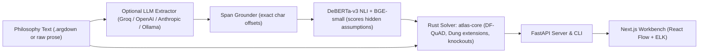

# Philosophy Argument Atlas (Dialectica Engine)

[](https://www.rust-lang.org/)
[](backend/pyproject.toml)
[](LICENSE)

Argument Atlas turns dense philosophical passages into formal argument hypergraphs, tests which hidden assumptions hold an argument together, and solves which claims survive under attack. It pairs a Rust formal argumentation solver (`atlas-core`) with a local PyTorch Natural Language Inference (NLI) filter (`atlas-ml`).

If you want the visual walkthrough first, read [the ADHD-friendly guide](docs/GUIDE.md).

---

## See it work in 30 seconds

Take a single passage from Fyodor Dostoevsky's *The Brothers Karamazov* (Book V, Ch. 4, Constance Garnett translation), stored in [03_dostoevsky_ivan_rebellion.argdown](datasets/phil-args/03_dostoevsky_ivan_rebellion.argdown):

> "Too high a price is asked for harmony; it is beyond our means to pay so much to enter on it. And so I hasten to give back my entrance ticket."

Ivan Karamazov's stated lines do not deductively entail his conclusion on their own. Two unspoken assumptions (*enthymemes*) carry the weight:
- `[E1]` No future good justifies using an innocent child's suffering as a means (credence `0.88`).
- `[E2]` If accepting cosmic harmony requires consenting to an immoral price, a moral agent must refuse it (credence `0.75`).

Run the Rust solver on that file:

```bash
cargo run --release -p atlas-cli -- inspect datasets/phil-args/03_dostoevsky_ivan_rebellion.argdown --strict-spans
```

In under 1 millisecond, `atlas-cli` checks every quote character-for-character against the source text, computes gradual `DF-QuAD` belief scores (`C = 0.7125`), and ranks the weakest assumptions that collapse Ivan's conclusion (`C -> 0.0000`) if rejected:

```text
 #1  Remove ["E2"] | epistemic_cost=0.75 | [C]: 0.7125 -> 0.0000 (drop=0.7125)
 #2  Remove ["E1"] | epistemic_cost=0.88 | [C]: 0.7125 -> 0.0000 (drop=0.7125)
```

---

## How the pieces fit



Most argument mapping tools treat arguments as simple arrows from one box to another and stop there. That breaks on philosophical texts for three concrete reasons:

1. **Linked premises (`SupportHyperedge`).** In Descartes' Cogito, "I think" (`P1`) only reaches "I exist" (`C`) when paired with "Whatever thinks must exist" (`E1`). Modeling them as one conjunctive hyperedge `[P1] & [E1] +> [C]` guarantees that knocking out `E1` breaks the inference even when `P1` stays true.
2. **Attacking a claim vs. attacking an arrow.** Following John Pollock (1987), a rebuttal (`->`) denies a proposition directly, while an undercutter (`_>`) breaks an inference hyperedge without claiming the conclusion is false. In [04_plato_euthyphro_dilemma.argdown](datasets/phil-args/04_plato_euthyphro_dilemma.argdown), Socrates undercuts Euthyphro's inference link (`H1` drops to `0.1191`).
3. **NLI cheating filters (`AbductiveNLIScorer`).** When asked for hidden premises, language models often emit lazy tautologies like `"If P, then C"` or restate `C` directly. Our local `DeBERTa-v3` and `bge-small` scorer measures actual entailment gain (`delta_nli`) while penalizing circular paraphrases and trivial conditionals.

---

## Quick start

### 1. Run the Rust solver and CLI

Requires Rust `1.75+` (tested on `rustc 1.96.0`).

```bash
git clone https://github.com/Bunlong-Prak/Philosophical-argument-atlas.git
cd Philosophical-argument-atlas

# Run the 8 Rust solver tests (DF-QuAD, Dung extensions, knockouts, Argdown round-trip)
cargo test

# Build release CLI and inspect Kant's Third Antinomy cycle
cargo build --release -p atlas-cli
./target/release/atlas-cli inspect datasets/phil-args/05_kant_third_antinomy.argdown --strict-spans
```

### 2. Run the Python ML suite and FastAPI server

Requires [uv](https://docs.astral.sh/uv/) and Python `3.11` to `3.13`. Models are sized to fit inside 8 GB of RAM on Apple Silicon (`MoritzLaurer/DeBERTa-v3-base-mnli-fever-anli` and `BAAI/bge-small-en-v1.5`).

```bash
cd backend
uv sync

# Run unit tests (span alignment, Rust IPC, graph aligner, FastAPI endpoints)
uv run pytest -v

# Start the local FastAPI server on http://127.0.0.1:8000
uv run uvicorn atlas_ml.api:create_app --factory --reload --port 8000
```

### 3. Launch the interactive Workbench UI (`web/`)

Requires Node.js `18+`. Open a second terminal while FastAPI runs on port `8000`:

```bash
cd web
npm install
npm run dev
```

Open [http://localhost:3000](http://localhost:3000). You can switch between the 6 primary passages, trace colored prose quotes to hypergraph nodes, drag assumption sliders to watch downstream beliefs collapse, and parse your own `.argdown` scripts or test hidden assumptions in the **Custom Text & NLI Lab** tab.

Optional research scripts (download Hugging Face weights on first run):

```bash
# Test NLI enthymeme ranking against circularity and tautologies on Descartes, Hume, Dostoevsky
uv run python scripts/eval_enthymeme_ablation.py

# Audit all 6 curated passages and run live BGE-small Hungarian graph alignment
uv run python scripts/eval_corpus_and_aligner.py
```

---

## What is inside

| Path | Role |
| :--- | :--- |
| [crates/atlas-core](crates/atlas-core/src/lib.rs) | Rust Bipolar Hypergraph model, span verifier, `DF-QuAD` solver, Dung compiler, knockout search, and `.argdown` parser/exporter. |
| [crates/atlas-cli](crates/atlas-cli/src/main.rs) | CLI binary supporting `inspect`, `solve --stdin`, and `convert`. |
| [datasets/phil-args](datasets/phil-args) | Six public-domain philosophical passages (Descartes, Hume, Dostoevsky, Plato, Kant, Mill) with verified character spans. |
| [backend/src/atlas_ml](backend/src/atlas_ml) | Span grounder, Rust IPC bridge, `DeBERTa-v3` NLI enthymeme scorer, Hungarian graph aligner, LLM extractor, and FastAPI app. |
| [web/src](web/src) | Next.js 16 + React Flow + ELK interactive Workbench UI (split source reader, layered hypergraph canvas, live sliders, NLI & `.argdown` lab). |
| [DESIGN.md](DESIGN.md) | Tokenized Critical-Edition Apparatus visual specification paired with `.impeccable/design.json`. |
| [docs/GUIDE.md](docs/GUIDE.md) | ADHD-friendly visual walkthrough of the concepts, files, UI panes, and API endpoints. |
| [docs/RESEARCH_LOG.md](docs/RESEARCH_LOG.md) | Running lab notebook recording bugs found, math fixes, and empirical results. |

---

## Roadmap

- [x] **Milestone 1 (Core Rust Engine):** Bipolar hypergraph model, `DF-QuAD` solver, Dung (`Grounded`, `Preferred`, `Stable`) compiler, Minimal Premise Knockout search, and `atlas-cli`.
- [ ] **Milestone 2 (Benchmark Corpus):** Bidirectional `.argdown` bridge and 6 verified public-domain passages (`PhilArgs-6`); next target is expanding to `PhilArgs-50`.
- [x] **Milestone 3 (Neuro-Symbolic Pipeline):** Deterministic span grounder, `DeBERTa-v3` NLI enthymeme scorer, multi-provider LLM JSON extractor (`Groq`, `OpenAI`, `Anthropic`, `Ollama`), and FastAPI service.
- [ ] **Milestone 4 (Hermeneutic Prism):** Hungarian bipartite graph aligner over `BGE` embeddings is complete; multi-model consensus benchmarking across live LLMs is next.
- [x] **Milestone 5 (Interactive Workbench UI):** Next.js split primary-text reader, ELK layered React Flow hypergraph canvas, live credence sliders with knockout testing, and offline `.argdown` + NLI lab backed by the local FastAPI + Rust engine.

---

## Author and license

Created by **Bunlong Prak (Nate)** ([@Bunlong-Prak](https://github.com/Bunlong-Prak)). Released under the [MIT License](LICENSE).
